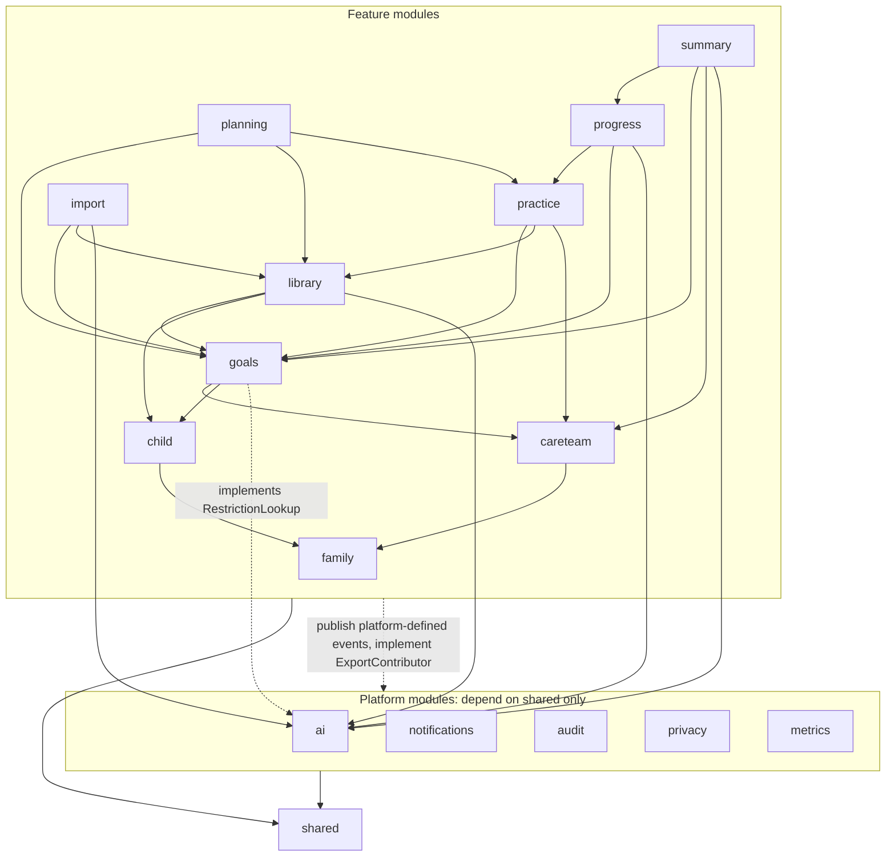
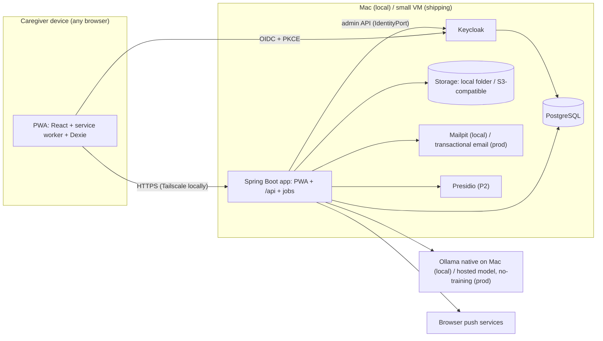
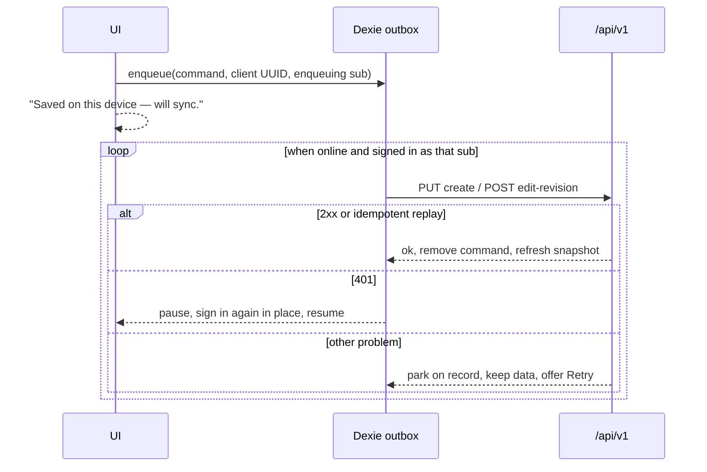
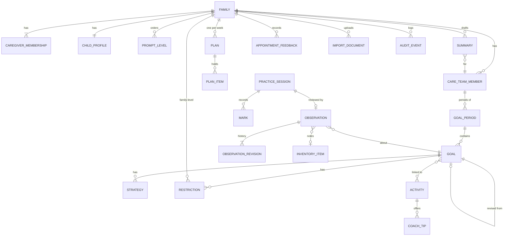

# Architecture Spine — LittleSteps v1

Terms follow the PRD glossary (§3). FR and § references point to the PRD; addendum §A–§E to its addendum; "UX" to EXPERIENCE.md.

## Design Paradigm

**Backend:** one Spring Boot application, organised as a **modular monolith** using Spring Modulith. Each module is a top-level package under `app.littlesteps`. Every external system sits behind a **port** (an interface the domain owns) with swappable **adapters** (hexagonal): AI, OCR, masking, file storage, identity admin, email, push and PDF.

**Client:** a React PWA that works **offline-first**. Reads come from the server or a local snapshot. Writes go into a **command outbox** that is replayed against idempotent endpoints.

| Layer (per backend module) | Package | Holds |
| --- | --- | --- |
| API | `<module>/api` | The only types other modules may import: query services, commands, published events, ports the module defines |
| Web | `<module>/web` | REST controllers and request/response DTOs |
| Domain | `<module>/domain` | Entities, value types, domain services |
| Persistence | `<module>/persistence` | JPA repositories (module-private) |
| Adapters | `<module>/adapter/<tech>` | Port implementations |



Solid arrows mean "may call the `api` of". `shared` holds the kernel: IDs, `FamilyCalendar`, `StoragePort`, the problem-type registry and the redacting value types.

## Invariants & Rules

### AD-1 — Module boundaries and the dependency graph are closed

- **Binds:** all backend code
- **Prevents:** modules reading each other's tables, dependency cycles, and teams guessing where event types live.
- **Rule:**
  - The modules and edges are exactly those in the diagram. A `ModularityTests` test runs `ApplicationModules.verify()` in CI. Adding a module or an edge means amending this AD.
  - Each module owns its tables. Other modules reach it only through its `api` package or through events. JPA associations never cross modules: a reference to another module's entity is by ID only. No module's `api` re-exports another module's entity shape.
  - Events that a **platform** module consumes are defined in that platform module's `api` (`audit.api.AuditableEvent`, `notifications.api.NotificationRequested`, `metrics.api.MetricEvent`). Feature modules publish them, so the dependency points from feature to platform.
  - Events between feature modules are defined in the publisher's `api`, and the listener needs a declared edge to the publisher. The one exception is `practice`, which publishes `library.api` engagement events over its existing edge (AD-10).
  - Cross-module listeners use `@ApplicationModuleListener` with the JPA event publication registry, so incomplete publications are resubmitted at startup. Payloads carry `family_id` and IDs only. Listeners are idempotent by event ID.

### AD-2 — Every Family-owned row is tenant-scoped by construction

- **Binds:** all persistence; FR-1; §5 privacy
- **Prevents:** a query path that forgets to filter by Family and leaks another Family's data.
- **Rule:**
  - Every Family-owned table has `family_id uuid NOT NULL REFERENCES families ON DELETE CASCADE`, mapped with Hibernate `@TenantId`.
  - The tenant resolver takes the Family from the authenticated Caregiver's active membership, never from a request parameter.
  - Tables without a Family (curated content, tombstones, `pilot_metric`, `invite` before acceptance) are listed in `backend/GLOBAL_TABLES.md`. Only those tables may omit `family_id`.
  - Only scheduled jobs (AD-16, AD-17) may use the Hibernate root tenant (`isRoot()`), and no request path can resolve to it.
  - Native SQL does not get the automatic tenant filter, so it must filter on `family_id` explicitly. A test checks every native query.
  - There is no operator role that can read Family content. Support access is OQ-1.

### AD-3 — Keycloak owns credentials; the app owns Family, membership, consent and invites [ADOPTED]

- **Binds:** FR-1; family module; frontend auth
- **Prevents:** membership or consent state split between Keycloak and the app, and sign-ups that bypass the invite-only pilot.
- **Rule:**
  - Keycloak holds credentials and login only. The PWA is a public OIDC client (authorization code + PKCE) with rotating refresh tokens. Spring validates JWTs as an OAuth2 resource server.
  - A Caregiver row is keyed by the token's `sub`. Display name and email are upserted from token claims on each new session. The first request under a new session ID emits `CaregiverSignedIn` for the audit log.
  - Families, memberships, invites and consent live only in `family`. An invite is an app-issued, single-use, expiring token: either a pilot invite issued by the operator, which allows creating a Family, or a Family invite. A Caregiver with no accepted invite gets problem type `invite-required`.
  - Until consent is recorded, every Family-data endpoint returns `consent-required`.
  - When a Caregiver leaves or is removed, the membership is ended, not deleted, so attribution keeps the display name. Caregivers are hard-deleted only by Family purge (AD-16).
  - A Caregiver belongs to at most one Family in v1.

### AD-4 — IDs: UUIDv7 for aggregates, UUIDv5 for curated content, idempotent creates

- **Binds:** every entity; the outbox (AD-5); AD-18 content
- **Prevents:** duplicate rows when a command is replayed, and curated IDs that change between environments or reseeds.
- **Rule:**
  - Primary keys are UUIDv7. The client generates the ID for every aggregate root that can be created offline: Practice Session, Observation (from Log a moment), Inventory item, and every form-created record.
  - A create is `PUT /api/v1/<collection>/{id}`. Replaying it is a no-op that returns the existing resource. After a create has synced, changes go as edit commands, never as a second create.
  - Child rows (Marks, adapt/skip events, displayed tips, Helpful toggles) have client UUIDs but exist only inside their aggregate's command. They have no endpoints of their own.
  - A curated item's ID is a UUIDv5 derived from its `slug`, and it never changes. Family records that capture shown content (a Cue or tip that helped, tips displayed) also store the item's `content_version`.

### AD-5 — Offline writes go through one command outbox, owned by one Caregiver

- **Binds:** frontend data layer; every write endpoint; NFR Resilience; UX › State Patterns
- **Prevents:** each screen inventing its own offline queue, writes credited to the wrong Caregiver on a shared device, and drafts lost on re-sign-in.
- **Rule:**
  - Every mutation goes through `outbox.enqueue(command)`, which writes it to IndexedDB (Dexie) before any network call. No component calls `fetch` for a write directly.
  - Each command records the `sub` that enqueued it, and it is replayed only under that same `sub`.
  - Unsent commands for the same target ID are coalesced, keeping the latest body. Undoing an unsent command removes it.
  - Replay is FIFO with backoff:
    - `401` pauses replay. The Caregiver signs in again in place, the app restores the route, and replay resumes.
    - `4xx` problems other than 401 are parked on the record with "Couldn't save just now… Retry", and the local data is kept.
    - Local reads and enqueue never wait on the network.
  - Every in-progress form, Review and draft (including a New Goal Period) autosaves to Dexie on change.
  - Dexie is wiped on sign-out, when a different `sub` signs in, on `membership-ended`, and on Family purge.

### AD-6 — Content records are revisioned, and concurrent edits are both kept

- **Binds:** Goal, Strategy, Restriction, Child Profile, Care Team Member, Observation, Inventory item, Appointment Feedback, Summary draft; FR-4, FR-14; UX "Two Caregivers at once"
- **Prevents:** one builder updating rows in place while another expects history, and a silent last-write-wins that drops a Caregiver's correction.
- **Rule:**
  - An edit to one of these records inserts a revision row with `caregiver_id`, `recorded_at` and `based_on_revision_id`. Rows are never updated in place and never deleted, except by Family purge. The current state is the latest revision received.
  - If `based_on_revision_id` is not the latest, the server still appends the revision and marks it `concurrent = true`. The UI shows both versions in History, newest first.
  - Undo of a saved Observation, such as "Not attempted", appends a `voided` revision.
  - Plan items, Activity preferences and reminder preferences are set-state, last-write-wins records, not revisioned.
  - `audit_event` is insert-only and holds IDs, enums and timestamps. The `audit` module writes it by consuming events.

### AD-7 — The client owns a Practice Session until the Review is saved

- **Binds:** FR-10, FR-12, FR-14; practice module; UX 12-hour stale session
- **Prevents:** half-open sessions on the server, and Marks and the Review saved by different paths.
- **Rule:**
  - While a session is open, its Marks, timer, adapt/skip events, the Coach Tips shown after each Mark, and Helpful toggles live only in Dexie.
  - The session reaches the server as one `CompletePracticeSession` command: the session, its child rows and the Review Observation. "Not attempted" and "Review it" from the stale-session prompt use the same command. "Close without review" discards the local session and sends nothing.
  - A Coach Tip request is read-only.

### AD-8 — Time: client occurrence, server attribution, Family-calendar bucketing

- **Binds:** FR-13, FR-14, FR-16, FR-17; §9 active day
- **Prevents:** a moment logged offline landing on the day it synced, and the client and server disagreeing about weeks.
- **Rule:**
  - Records that can be captured offline carry a client `occurred_at`. The server clamps it to `[recorded_at − 14 days, recorded_at]`. `recorded_at` and `caregiver_id` always come from the server and the token.
  - Instants are stored as `timestamptz` (UTC). The Family holds an IANA `timezone` and a `week_start` (default Monday). All day, week and period bucketing uses `occurred_at` through `shared.FamilyCalendar` on the server.
  - A Plan is keyed by `(family_id, week_start_date)` and generated with `INSERT … ON CONFLICT DO NOTHING`, then read. No code copies items between weeks. A `week_start` change takes effect from the next week.

### AD-9 — Ownership of shared domain concepts

- **Binds:** FR-3, FR-4, FR-6, FR-7, FR-8, FR-12, FR-14, FR-15
- **Prevents:** two modules owning the same concept.
- **Rule:**

  | Concept | Owner | Notes |
  | --- | --- | --- |
  | Prompt Level list (per Family) and each Care Team Member's mapping | `careteam` | Stable IDs with an ordinal. Levels are retired, never deleted. Criteria and Observations store the level ID and a snapshot of its ordinal. |
  | Status Vocabulary | `careteam` | Same retire-only rule. |
  | Goal Period | `goals` | Belongs to one Care Team Member. A parent-proposed Goal names `proposed_to` (a Care Team Member) and sits in that member's current period. |
  | Strategy, Restriction | `goals` | |
  | Activity (curated, prescribed, AI), Goal↔Activity links, Coach Tips | `library` | One ID space. `import` creates prescribed Activities through `library.api`. |
  | Favourite and hidden | `library` | Per Family. Hidden excludes an Activity from suggestions and the Plan, but not from Browse. |
  | Engagement history, tip helpfulness, ranking | `library` | A projection of `library.api.ActivityEngaged` and `TipFeedbackRecorded`, which `practice` publishes from `CompletePracticeSession`. |
  | Practice Session, Observation, Inventory item | `practice` | An Inventory item is unique per `(family, list, normalised_text)`. A colliding create merges, and the earliest `first_seen_at` wins. Log a moment references an `inventory_item_id`. |
  | Plan, reminder preferences (per Caregiver), `next_reminder_at` | `planning` | |
  | Summary, Appointment Feedback | `summary` | Feedback changes Goals only through `goals.api` commands (AD-13). |
  | Push subscriptions (per Caregiver), notification templates | `notifications` | |

### AD-10 — Every record carries a typed Source and an origin; Care Team wording is immutable

- **Binds:** FR-4, FR-5, FR-7, FR-9, FR-12, FR-17
- **Prevents:** AI or a Caregiver edit overwriting a therapist's wording, and modules each inventing their own way of telling content apart.
- **Rule:**
  - Goal, Strategy, Restriction, Activity and Coach Tip carry `source_ref = {kind ∈ {care_team_member, caregiver}, id}` and `origin ∈ {prescribed, curated, ai_suggested, parent_proposed}`.
  - `original_text` is write-once. A Caregiver edit or a simplification goes in `caregiver_text`.
  - Activities whose origin is `prescribed` are never sent to AI for rewriting.
  - Review Status lives on Goal: Care Team Goals are `confirmed`, and parent-proposed Goals start as `proposed`.

### AD-11 — One Restriction lookup, a versioned check, and fail-closed suggestions

- **Binds:** FR-2, FR-7, FR-9, FR-12, FR-13, FR-18; §5 clinical safety
- **Prevents:** sensitivities and Care Team Restrictions checked by different paths, stale checks after a new Restriction, and a therapist's Activity silently hidden.
- **Rule:**
  - `ai` defines the `RestrictionLookup` port, and `goals` implements it. It returns the Family's Restriction set (Restriction rows for the Goal and the Family, plus the Child Profile sensitivities marked "avoid", read live from `child.api`; no derived copies) and a `restriction_set_version`.
  - `Guardrail.check(items, scope)` runs a deterministic Restriction match first, then the scope classifier, which can add the label "check with your therapist". Every endpoint that returns Activities, Plan items, Prep cards or Coach Tips runs it, and results are cached against `restriction_set_version`.
  - Curated and AI items that fail, or can't be checked, are dropped. Prescribed Activities are never dropped: on a match they are shown with a "conflicts with a recorded Restriction — check with your therapist" flag.

### AD-12 — All AI access goes through named, allow-listed, budgeted AI tasks

- **Binds:** FR-5, FR-9, FR-12, FR-16, FR-17; §5 privacy; §6 Cost, Speed; addendum §A.5
- **Prevents:** a feature module calling a model directly with whatever data it holds, a slow local model blocking tips, and costs above the US$5 ceiling.
- **Rule:**
  - Only `ai` depends on Spring AI. It exposes one `AiTask<I, O>` per use case: `ExtractDraftItems`, `SuggestActivities`, `SuggestCoachTips`, `DescribeProgress`, `DraftSummaryText`, `SuggestQuestions`.
  - Each input `I` is a record built only from allow-listed fields: the nickname or "the child", plus Goal, Strategy and Observation content. It has no field for identifiers.
  - Each output `O` is structured and validated against a schema, then passes AD-11 (suggestions) or AD-13 (descriptive text).
  - `ExtractDraftItems` and `DraftSummaryText` are asynchronous jobs with status and cancel. `SuggestCoachTips` has a 1.5-second timeout, after which only curated tips are shown.
  - `ai` keeps a per-Family monthly usage counter. Above a configured soft cap, AI tasks return "unavailable" and the product falls back to curated content.
  - The provider and model are chosen by configuration alone (`local` uses Ollama, `prod` uses a hosted provider set not to train on user data).

### AD-13 — AI text is cited and kept apart from Caregiver text; only Feedback sets Goal status

- **Binds:** FR-16, FR-17, FR-18
- **Prevents:** a Summary sentence that cannot be traced to Observations, a validator deleting Caregiver edits, two implementations of the measures, and an AI-assigned "Achieved".
- **Rule:**
  - Per-Goal measures (consistency, performance, generalisation, Observation count and the "fewer than 5" flag) for a Goal lineage and date range are computed only by `progress.api.GoalMeasuresQuery`. `summary` never aggregates Observations itself.
  - AI sentences carry at least one Observation ID from the requested scope. The server drops any sentence with no citation, or one outside the scope. AI sentences are stored immutable, apart from Caregiver-written blocks, and the citation rule applies only to AI sentences.
  - No AI output schema has a status field. Goal status and Review Status change only through `goals.api` commands issued by Appointment Feedback, using a value the Caregiver picks from the Care Team Member's Status Vocabulary.
  - `ConfirmSummaryShare` freezes a snapshot of the current revision and emits an `AuditableEvent`. The PDF is rendered server-side from that snapshot and fetched before the share sheet opens. Where `navigator.canShare({files})` fails, the client offers a download instead.

### AD-14 — Import is a gated state machine, and nothing unmasked reaches AI

- **Binds:** FR-5; import module; addendum §E
- **Prevents:** an extraction path that skips the masking confirmation, or passes the original file to the model.
- **Rule:**
  - An import moves through `uploaded → text_read → masking_confirmed → extracted → reviewed`. Each transition is a separate command.
  - `ExtractDraftItems` accepts only a `MaskedDocument`, which only `import` can construct, from a `masking_confirmed` import: masked text lines plus the covered page image.
  - Originals are encrypted by the app (AD-21), stored through `StoragePort` with `retain_until = upload + 12 months`, and never enter `ai`.
  - `OcrPort` returns text lines with bounding boxes, in reading order. `MaskingPort` (the Presidio adapter, addendum §A.8) returns the spans it detected.
  - Extracted items stay drafts until the Caregiver confirms them. Confirming writes through `goals.api` and `library.api` (AD-10 applies).

### AD-15 — The offline set is one guardrail-checked snapshot, read in one way

- **Binds:** NFR Resilience, Speed; FR-11, FR-12; addendum §B (iOS storage eviction)
- **Prevents:** offline tips that were never checked, online and offline views of the Plan that disagree, and stale safety data.
- **Rule:**
  - `GET /api/v1/offline-snapshot` returns the current Plan, its Prep cards, ranked and checked curated Coach Tips for those Activities, and `restriction_set_version`.
  - The client refreshes the snapshot on app open, on focus, when it comes back online, and after each outbox sync. A newer `restriction_set_version` replaces it entirely.
  - Resources in the offline set are read only through a Dexie-backed query function that overlays pending outbox commands. TanStack Query wraps that function.
  - The app calls `navigator.storage.persist()` at first sign-in.

### AD-16 — Deletion, retention and export each have one owner and reach every copy

- **Binds:** §5 export, deletion, pilot end; §10.2-1, §10.2-6
- **Prevents:** a table left out of export, Caregiver accounts or backups that outlive "permanent" deletion, and two modules running the purge.
- **Rule:**
  - `family` owns the deletion request (`purge_after = now + 7 days`, undoable by any Caregiver), the purge, and Caregiver removal from Keycloak through `IdentityPort`. Purge deletes the `families` row (cascading under AD-2) and the `families/{id}/` storage prefix, then writes a tombstone with no content.
  - Pilot end is a configured `pilot_end_at`. It drives the advance announcement through `notifications`, then the same purge for every Family.
  - `import` owns the retention purge of originals.
  - `privacy` owns export only. Every module with Family tables implements `privacy.api.ExportContributor`, and a test fails if one is missing. An export is an asynchronous, encrypted archive stored under the Family's storage prefix, behind an expiring link, and audited.
  - Backups (database and storage volume) are kept for at most 14 days. After any restore, purge re-runs against the tombstones. The encryption key is held outside the backups.

### AD-17 — Background jobs are idempotent and driven by due-state

- **Binds:** reminders (FR-13), retention of originals, Family purge, pilot end, export
- **Prevents:** duplicate or stale reminders, and double deletion when a job reruns or the host wakes from sleep.
- **Rule:**
  - Jobs use `@Scheduled`. Each one selects rows by a due column (`next_reminder_at`, `purge_after`, `retain_until`) and claims them with `UPDATE … WHERE` so that running twice has no extra effect. Each job records its last run time, and that time is exposed in the actuator health endpoint.
  - The reminder job (owned by `planning`) sends at most one reminder per Plan day, never on a day with no Plan item, and skips any reminder more than one hour overdue. It publishes `NotificationRequested`.
  - Security notices (membership changes, Family deletion) are a separate category that reminder limits never suppress. They go to the other Caregivers as a banner, an email, and push if that Caregiver opted in.
  - One app instance.

### AD-18 — UI wording lives in the client; curated content lives in reviewed files

- **Binds:** NFR Language; FR-8, FR-11, FR-12; UX Voice and Tone
- **Prevents:** sentences hard-coded in Java responses that can't be translated, and curated content edited without professional review.
- **Rule:**
  - The server returns codes and enums, never UI sentences. All UI copy lives in frontend message catalogs.
  - The exceptions are content: curated items, AI text, and notification and email templates (in the `notifications` catalog).
  - Curated Activities, Cues and Coach Tips are YAML files under `content/`, each with a `slug` and a `content_version`. A loader runs after Flyway at startup and upserts them by their UUIDv5 ID. They are global and read-only at runtime.

### AD-19 — Child content is never logged

- **Binds:** NFR Observability; all code
- **Prevents:** a debug log or exception message that writes Observation text, a nickname or a prompt into the logs.
- **Rule:**
  - Free text that comes from Caregivers or AI is held in `shared` value types (`CaregiverText`, `AiText`) whose `toString()` returns `[redacted]`.
  - Logs and traces carry IDs, enums, durations and counts only. Prompts and model outputs are never logged.
  - Metrics are counters published as `metrics.api.MetricEvent`: AI evaluation figures (Restriction-check failures, scope-label rate, tip helpfulness) and pilot figures (§9). `metrics` stores counts-only aggregates in the global `pilot_metric` table.

### AD-20 — One API contract, and one persistence-migration layout

- **Binds:** every endpoint, frontend call and schema change
- **Prevents:** TypeScript types that drift from the Java DTOs, an error shape that differs by module, and Flyway version collisions between teams.
- **Rule:**
  - The REST API serves JSON under `/api/v1`. Errors are RFC 9457 `application/problem+json`, with `type` drawn from `shared/web/ProblemTypes`. The client maps `type` to catalog copy.
  - springdoc generates `openapi.json`, and the frontend generates its types with `openapi-typescript`, run in its own toolchain (`npx -p typescript@5.9.3 -p openapi-typescript@7.13.0`) because it does not support TypeScript 7. The frontend has no hand-written API types.
  - There is one Flyway history. Files live in `db/migration/<module>/` with timestamped versions (`V20261105_1430__…`). Migrations are forward-only, and breaking changes use expand-then-contract.

### AD-21 — Encryption and transport

- **Binds:** FR-5; §5 encryption at rest and in transit
- **Prevents:** a storage adapter that writes plaintext originals or exports.
- **Rule:**
  - `StoragePort` adapters receive only ciphertext (AES-GCM, with the key and a key ID from the environment). The key ID is stored with each object.
  - PostgreSQL and the storage volumes sit on encrypted disks.
  - All traffic uses TLS: Tailscale HTTPS in local device testing, and a real domain when shipping.

### AD-22 — One deployable, configured only by environment [ADOPTED direction]

- **Binds:** §6 Deployment, Cost; addendum §A.1, §A.7
- **Prevents:** code paths that differ between local and shipping, and configuration scattered across code.
- **Rule:**
  - Production runs one app image, in which Spring Boot serves the built PWA at the same origin as `/api`. In local development, the Vite dev server proxies `/api`.
  - Keycloak, PostgreSQL, Mailpit (local only) and Presidio (P2) run from one `deploy/compose.yaml`, with an env-file per environment. Ollama runs natively on the host.
  - Adapters are selected by Spring profile (`local`, `test`, `prod`) plus environment variables. There are no environment checks in code. Secrets come only from the environment.

### AD-23 — The client data layer has one shape

- **Binds:** frontend
- **Prevents:** each feature choosing its own state library or cache.
- **Rule:**
  - Server reads use TanStack Query.
  - The offline snapshot, drafts and the outbox use one Dexie database (AD-5, AD-15).
  - The service worker (vite-plugin-pwa, Workbox) precaches the app shell only, never API responses.
  - Server data is never mirrored into a global client store.
  - UI primitives come from Radix, styled with plain CSS modules that use DESIGN.md tokens exposed as CSS custom properties. The frontend uses npm.

### AD-24 — Tests run against real infrastructure, and guardrails are a release gate

- **Binds:** all modules; FR-9, FR-12; §10.2-3
- **Prevents:** tests passing on H2 while PostgreSQL behaves differently, and a model change shipping without the guardrail evaluation.
- **Rule:**
  - Persistence and integration tests use Testcontainers PostgreSQL.
  - The guardrail evaluation set (at least 30 cases) lives in `eval/guardrails/*.yaml` and runs as the JUnit tag `guardrail-eval` against the model configured for an environment.
  - A pilot release needs a passing report for that environment's model.

## Consistency Conventions

| Concern | Convention |
| --- | --- |
| Naming | PRD glossary terms, verbatim, in code (`PracticeSession`, `CoachTip`, `GoalPeriod`, `CareTeamMember`). Tables use snake_case singular nouns. Events are past tense (`ObservationRecorded`, `CaregiverRemoved`). |
| IDs | UUIDv7 (curated content: UUIDv5) as strings in JSON (AD-4). |
| Dates | ISO 8601. Instants in UTC with a `Z` suffix. Family-local dates as `YYYY-MM-DD` (AD-8). |
| Attribution | `caregiver_id` and `recorded_at` come from the server. `occurred_at` comes from the client and is clamped (AD-8). |
| Errors | RFC 9457 problem types from one registry (AD-20). |
| Auth | Bearer JWT on `/api/**`. Membership, invite and consent checks run in a single filter. |
| Config | Spring profiles plus environment variables only. No secrets in the repo. |
| Units | A Criterion `kind ∈ {trials, duration_minutes, count, frequency_per_session}`. Observations store values in the Goal's Criterion kind. Prompt Level is stored as an ID plus an ordinal snapshot (AD-9). |
| Enums shared with the client | Mark, engagement scale, origin, Review Status and import state are server enums, exported through OpenAPI. |

## Stack

Versions checked on the web on 2026-11-05. Pin the exact patch versions at scaffold time. The code owns this section after that.

| Name | Version |
| --- | --- |
| Java (LTS) | 25 |
| Spring Boot | 4.1.2 |
| Spring Modulith | 2.1.2 |
| Spring AI | 2.0.2 |
| Hibernate (7.4), Flyway, Spring Security, Testcontainers (2.x module names) | Spring Boot 4.1 BOM |
| PostgreSQL | 18.6 |
| Keycloak | 26.8.1 |
| React | 19.3.1 |
| Vite | 8.x |
| vite-plugin-pwa | 2.0.0 |
| TanStack Query | 5.x |
| Dexie | 4.4.7 |
| Radix Primitives | latest at scaffold |
| TypeScript (app) | 7.0.x |
| openapi-typescript (codegen, run with its own TypeScript 5.9.3) | 7.13.0 |
| springdoc-openapi | latest compatible with Spring Boot 4.1 |
| openhtmltopdf (`io.github.openhtmltopdf`) | 1.1.108 |
| zerodep-web-push-java | 2.1.5 |
| Presidio (P2, `ghcr.io/data-privacy-stack/presidio-*`) | 2.2.366 |
| Mailpit, Ollama | latest (local only) |

**Release line:** if scaffolding happens after Spring Boot 4.2 GA, move Boot 4.2.x, Spring Modulith 2.2.x and Spring AI 2.1.x together, never mixed with the 4.1 set.

**Starters:** Spring Initializr (Spring Boot 4.1, Java 25, Maven) for `backend/`. `npm create vite@latest` with the `react-ts` template, plus vite-plugin-pwa, for `frontend/`.

## Structural Seed

### Runtime and environments



| | Local (now) | Shipping (decided at launch) |
| --- | --- | --- |
| App | IDE run, profile `local`, Vite dev server proxying `/api` | One container image, profile `prod` |
| Infrastructure | `docker compose -f deploy/compose.yaml --env-file deploy/local.env up` | The same compose file with `prod.env` on a VM |
| Backups | None needed | Nightly database and storage-volume backups, kept 14 days (AD-16) |
| AI | Ollama on the host | Hosted provider set not to train on user data, within the US$5 per Family ceiling |
| HTTPS | `localhost`, or Tailscale for real devices | A real domain with TLS |

### Write path (offline-tolerant)



### Core entities (names and relationships only)



### Source tree

```text
little-steps/
  backend/                 # Spring Boot (Maven), packages app.littlesteps.<module>; db/migration/<module>/
  frontend/                # React + Vite PWA
  content/                 # curated Activities, Cues, Coach Tips (YAML, professionally reviewed)
  eval/guardrails/         # >=30 Restriction and scope cases (AD-24)
  deploy/                  # compose.yaml, *.env.example, Keycloak realm export
```

## Capability → Architecture Map

| Capability | Lives in | Governed by |
| --- | --- | --- |
| FR-1 Accounts, Family, consent, invites | `family`, Keycloak | AD-2, AD-3, AD-16, AD-17 |
| FR-2 Child Profile | `child` | AD-6, AD-11 |
| FR-3 Care Team Members, Status Vocabulary, Prompt Levels | `careteam` | AD-6, AD-9 |
| FR-4 Manual Goals | `goals` | AD-6, AD-9, AD-10 |
| FR-5 Import with masking (P2) | `import`, `ai` | AD-12, AD-14, AD-21 |
| FR-6 Goal Periods and lineage | `goals` | AD-8, AD-9 |
| FR-7 Strategies, Restrictions, prescribed Activities | `goals`, `library` | AD-9, AD-10, AD-11 |
| FR-8 Activity library | `library`, `content/` | AD-4, AD-9, AD-18 |
| FR-9 AI Activity suggestions (P2) | `library`, `ai` | AD-11, AD-12, AD-24 |
| FR-10 Prep, activity, review | `practice`, frontend | AD-5, AD-7 |
| FR-11 Prep card | `library`, frontend | AD-15 |
| FR-12 Marks and Coach Tips | `practice`, `library`, `ai` | AD-7, AD-9, AD-11, AD-12, AD-15 |
| FR-13 Weekly Plan and reminders | `planning`, `notifications` | AD-8, AD-11, AD-17 |
| FR-14 Review and Log a moment | `practice` | AD-4, AD-5, AD-6, AD-8 |
| FR-15 Inventory and tagged notes (P2) | `practice` | AD-6, AD-9 |
| FR-16 Progress view | `progress` | AD-8, AD-13 |
| FR-17 Period Summary, PDF and share | `summary` | AD-13 |
| FR-18 Appointment Feedback | `summary` → `goals.api` | AD-9, AD-13 |
| §5 Export, deletion, retention, audit log, pilot end | `family`, `privacy`, `import`, `audit` | AD-6, AD-16, AD-17 |
| §6 Observability, cost; §9 metrics | `metrics`, `ai` | AD-12, AD-19 |

## Open Questions

| ID | Question | Revisit when |
| --- | --- | --- |
| OQ-1 | How does a Caregiver grant support time-limited access (§5)? A leading option is an audited, expiring, read-only grant row that the AD-2 resolver honours. | Before the pilot launches |
| OQ-2 | Which local and hosted models? Chosen by the AD-24 evaluation pass plus the cost ceiling. The AD-12 soft cap value is set at the same time. | At the start of P2 |
| OQ-3 | Which OCR adapter (a Tesseract container or a vision model) implements `OcrPort`? | At the start of the FR-5 epic |

## Deferred

- **More than one app instance** (distributed job locks). One instance meets pilot scale, and AD-17 jobs are already safe to rerun. Revisit if the app is scaled out.
- **Production host and provider.** The PRD defers this to launch. AD-22 keeps it a configuration change.
- **Email provider for shipping.** It sits behind the `notifications` email port.
- **Summary PDF layout.** It follows DESIGN.md. Only the renderer (openhtmltopdf, server-side, from the snapshot) is fixed here.
- **Observability backend.** Structured JSON logs to stdout are enough for now. AD-19 governs their content.
- **Therapist logins and multiple children per Family (v2).** `source_ref.kind` and Family tenancy leave room for both.
- **Share-target import on Android.** It is post-v1 (addendum §B).
