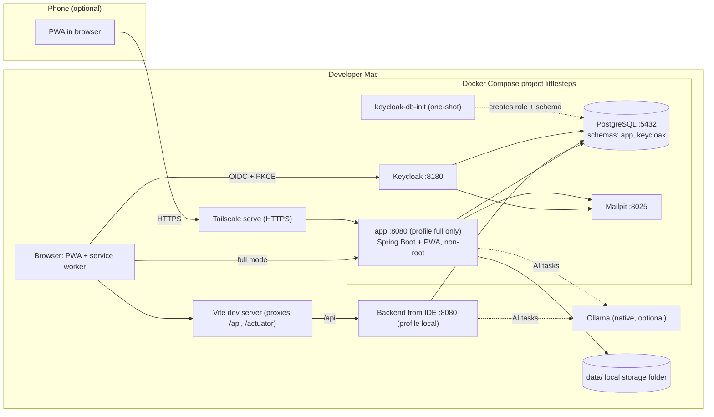
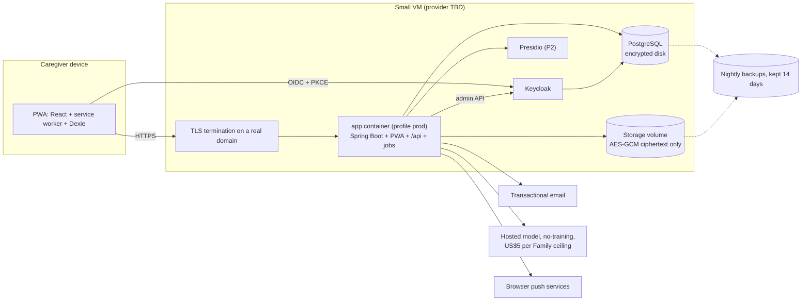
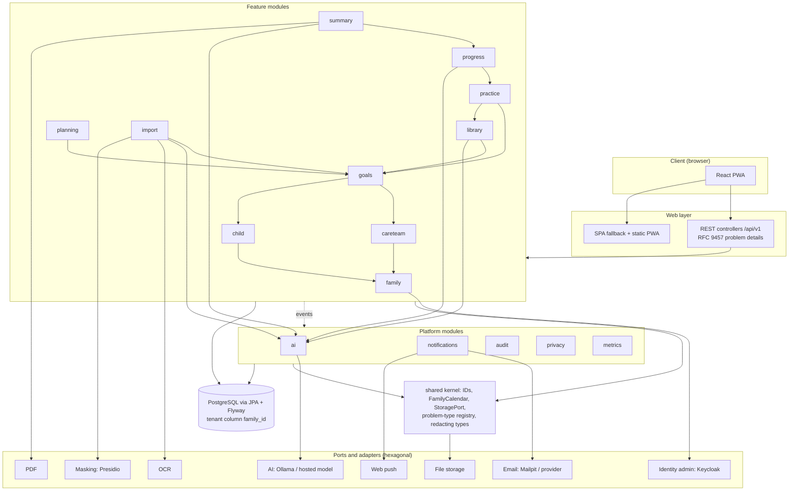
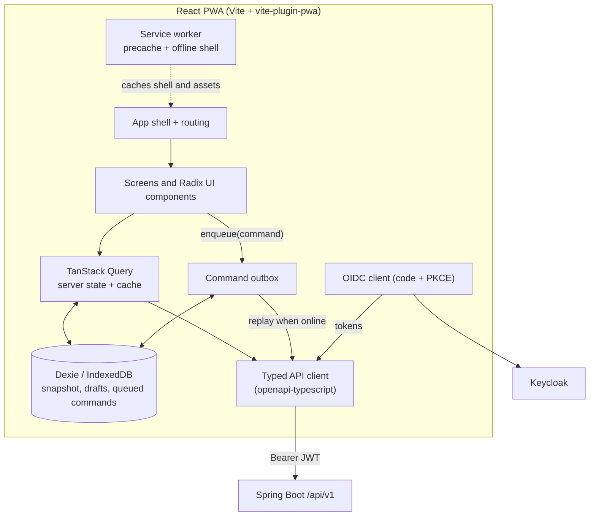

# Architecture diagrams

Two views of LittleSteps: where it runs (local and cloud) and what it is made of (components). The rules behind them live in the [architecture spine](../.specs/planning-artifacts/architecture/architecture-little-steps-2026-11-05/ARCHITECTURE-SPINE.md) (AD-1 module graph, AD-22 deployment); this page only draws them. If a diagram and the spine disagree, the spine wins: fix the diagram.

Status legend: solid boxes exist today; dashed boxes are planned and arrive with later stories.

## 1. Infrastructure: local and cloud

### Local (available now)

Everything runs on one Mac. Ports are the defaults from `deploy/local.env`; the compose file is `deploy/compose.yaml`.

Development mode uses `ide` and `vite`; full mode (`deploy/dev-up.sh --full`) uses `app`. Both talk to the same PostgreSQL, Keycloak and Mailpit.

### Cloud (planned: hosting is decided at launch)

The spine fixes the shape, not the provider: the same compose file and the same app image on a small VM, with managed or hosted services swapped in by Spring profile `prod` and environment variables (AD-22).

| Concern | Local | Cloud |
|---|---|---|
| App | IDE run or `--full` image | One container image, profile `prod` |
| Email | Mailpit (catches all mail) | Transactional email provider |
| AI | Ollama on the host | Hosted model set not to train on user data |
| Storage | `data/` folder | Encrypted volume or S3-compatible store |
| HTTPS | `localhost`, or Tailscale for real devices | Real domain with TLS |
| Backups | none | Nightly, 14 days |

## 2. Components

### Backend: modules and ports

One Spring Boot app, a modular monolith (Spring Modulith). Each module is a package under `app.littlesteps`. Solid arrows mean "may call the `api` package of"; the closed set of edges is AD-1 and is checked by `ApplicationModules.verify()`. Only the application shell exists today; the modules arrive with their epics.

### Frontend: PWA components

Offline-first. Reads come from the server or a local snapshot; every write goes through one command outbox (AD-5, AD-23).

Today the frontend is the scaffold (`App.tsx`, `main.tsx`); the boxes above fill in with the data-layer and authentication stories.

## Keeping these current

Update this page in any story that adds a module, a container, an adapter or an environment, and record it in the changelog's Operations impact table ([CONTRIBUTING](CONTRIBUTING.md#finishing-a-story)).
