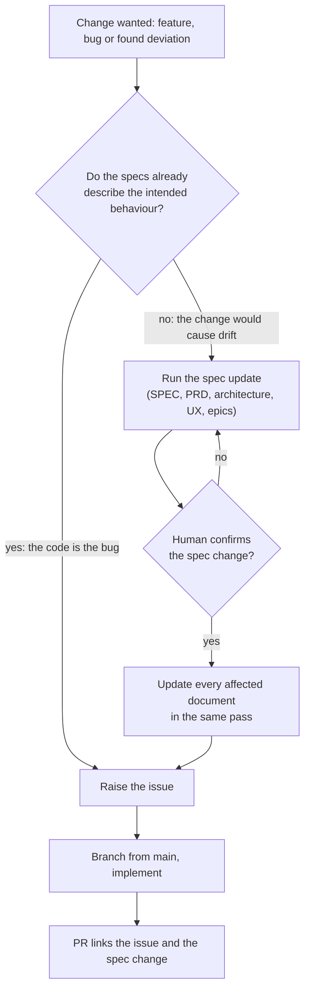
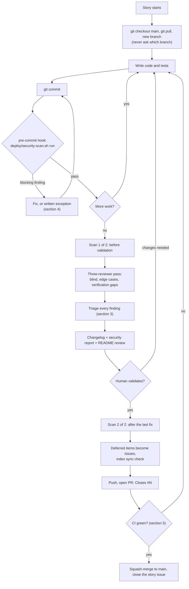
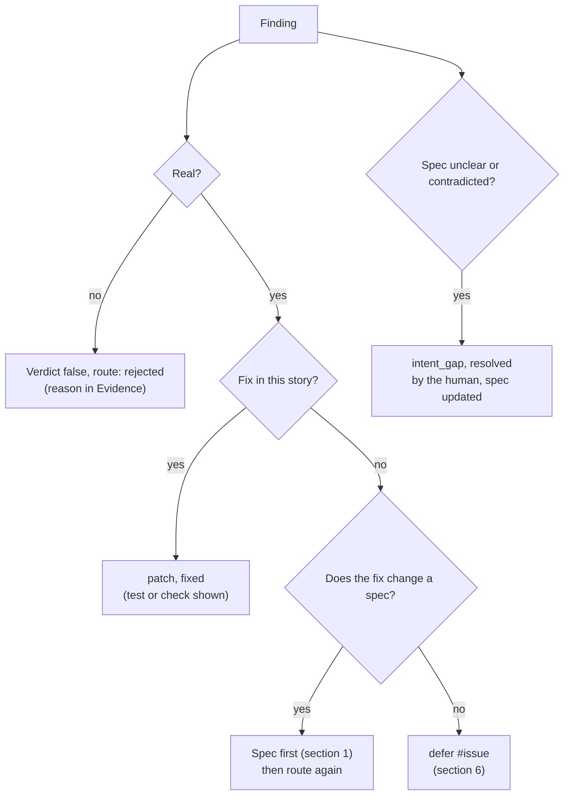
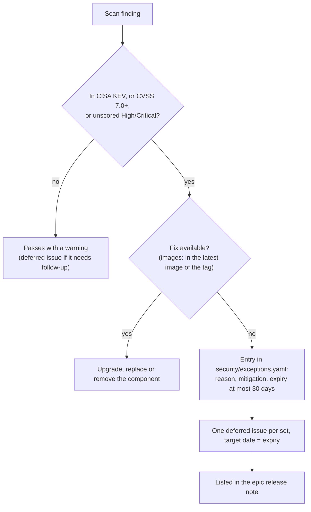
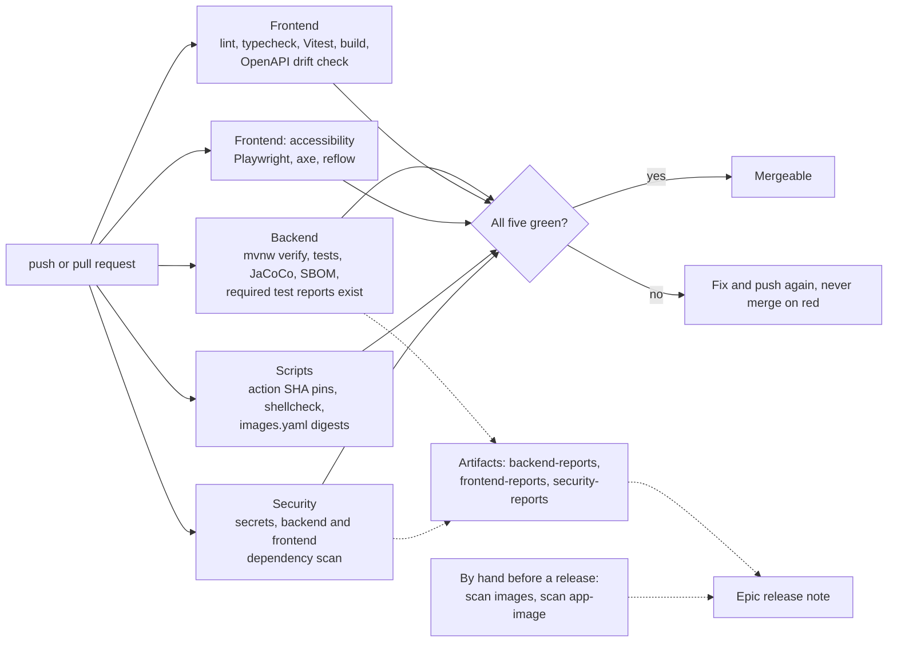
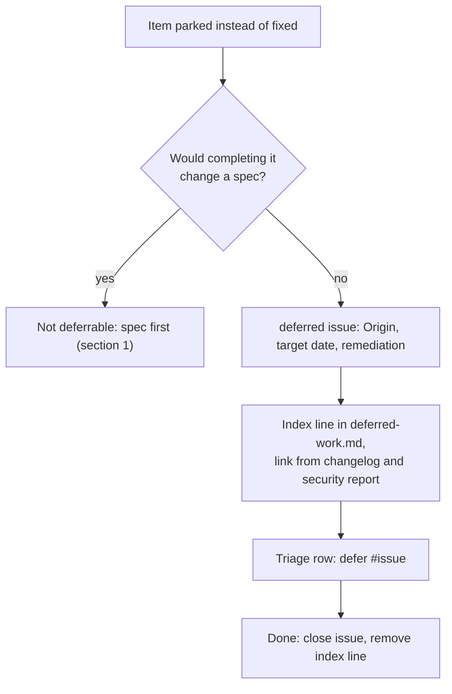
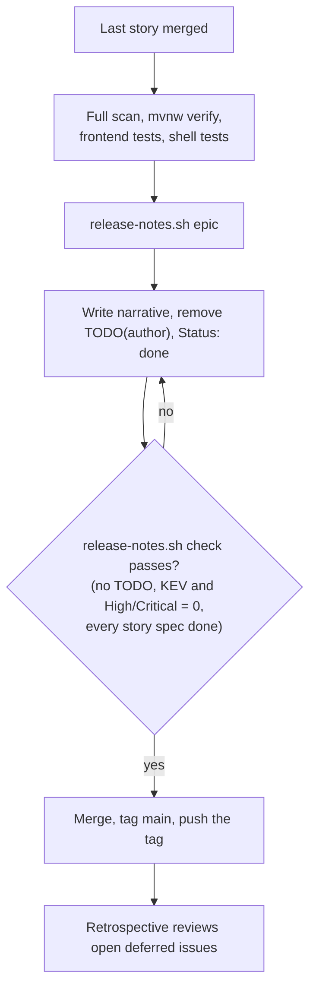
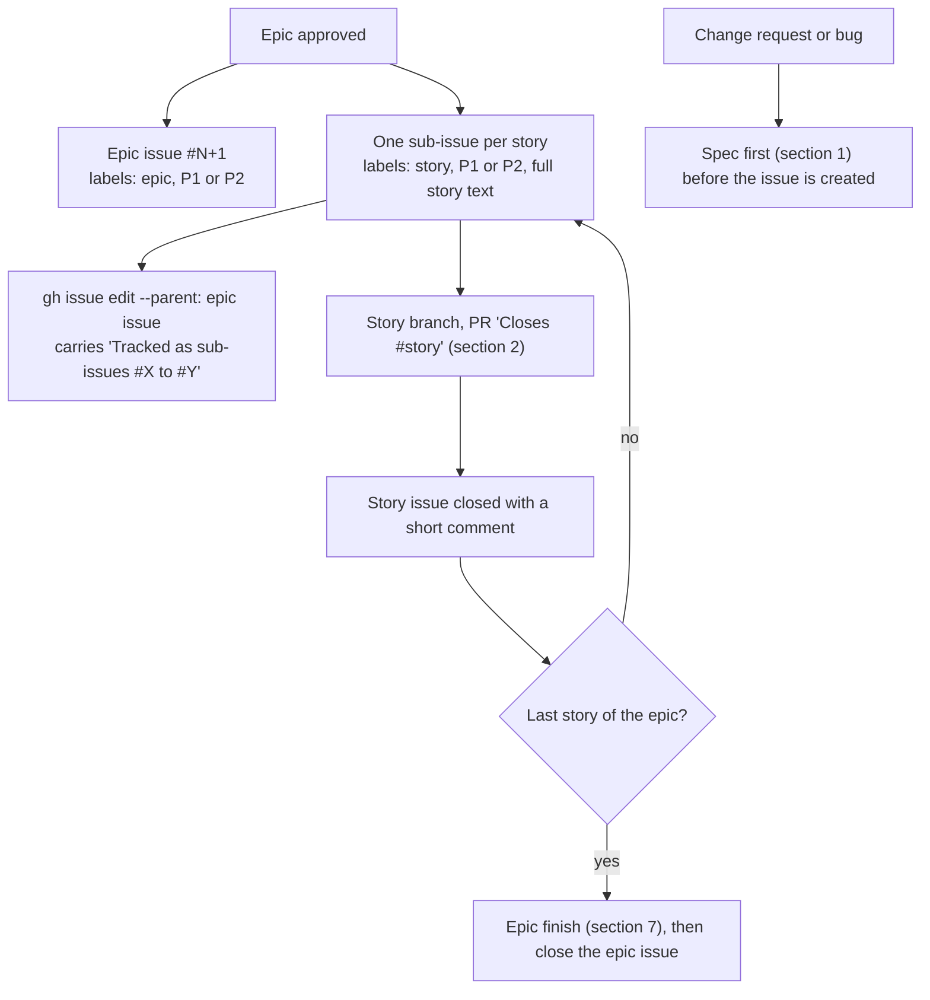

# Development workflow

The decision trees behind the policies, drawn once. This page only draws them: the rules live in [CONTRIBUTING.md](CONTRIBUTING.md), the scan policy in [security/README.md](../security/README.md), the deferred process in [deferred-items.md](deferred-items.md) and the CI job list in the [README](../README.md#continuous-integration). If a diagram and its rule disagree, the rule wins: fix the diagram.

## 1. A change arrives: spec first

Rule: [Spec first](CONTRIBUTING.md#spec-first).

## 2. A story, start to merge

Rules: [Branching](CONTRIBUTING.md#branching), [Security gate](CONTRIBUTING.md#security-gate), [Finishing a story](CONTRIBUTING.md#finishing-a-story).

The review pass, changelog and security report all exist before the human is asked to validate.

## 3. Review triage routing

Rule: [Review triage log format](CONTRIBUTING.md#review-triage-log-format).

A row never stays plain `patch` at the second scan or the last commit.

## 4. Security finding

Rule: [security/README.md](../security/README.md#blocking-rule).

## 5. Continuous integration

Rule: [Continuous integration](CONTRIBUTING.md#continuous-integration). Jobs and artifacts: [README](../README.md#continuous-integration). Workflow: [ci.yml](../.github/workflows/ci.yml).

## 6. Deferred item

Rule: [Deferred items](CONTRIBUTING.md#deferred-items), process in [deferred-items.md](deferred-items.md).

## 7. Finishing an epic

Rule: [Finishing an epic](CONTRIBUTING.md#finishing-an-epic).

## 8. Epic and story issues

Rule: [Issues](CONTRIBUTING.md#issues).

## Keeping this current

Update this page in any change to a policy or to the CI workflow, in the same PR.
